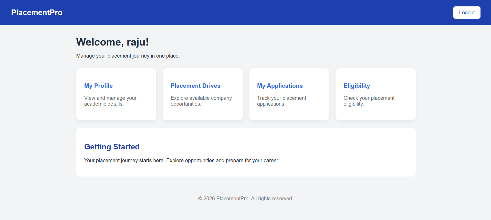
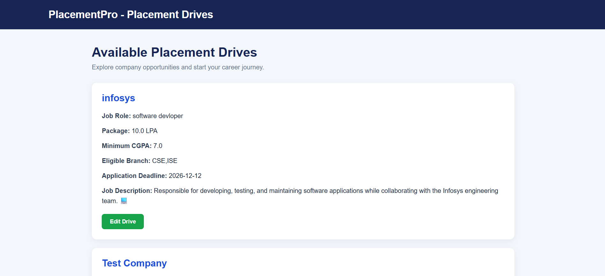
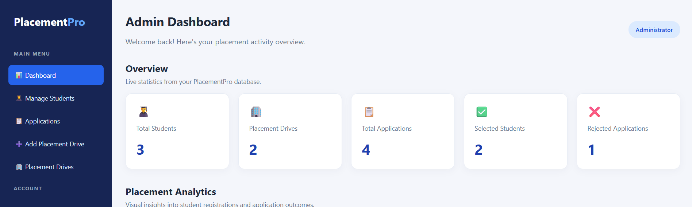
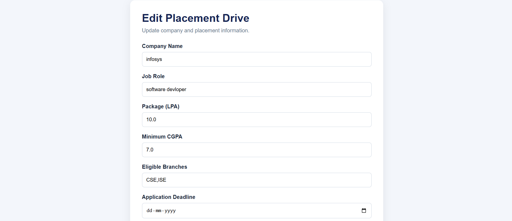

# PlacementPro 🎓

### Java Full Stack Placement Management System

PlacementPro is a web-based placement management application developed using Java, Spring Boot, MySQL and Thymeleaf. It helps students explore placement opportunities, check eligibility and track applications while allowing administrators to manage placement activities.

## 🚀 Features

- Student Registration and Login
- Student Dashboard
- Student Profile Management
- Placement Drive Listings
- CGPA and Branch-based Eligibility Checker
- Placement Application Tracking
- Admin Dashboard
- Student and Placement Drive Management
- Edit and Update Placement Drives

## 📸 Application Screenshots

### 1. Homepage


### 2. Student Dashboard


### 3. Placement Drives


### 4. Admin Dashboard


### 5. Edit Placement Drive


## 🛠️ Technologies Used

| Technology | Purpose |
|---|---|
| Java 21 | Backend Programming |
| Spring Boot | Backend Framework |
| MySQL | Database |
| Spring Data JPA | Database Integration |
| Thymeleaf | Frontend Templating |
| HTML & CSS | User Interface |
| Maven | Dependency Management |
| IntelliJ IDEA | Development Environment |

## ⚙️ Installation and Setup

### Prerequisites

- Java JDK 21
- MySQL 8.4
- IntelliJ IDEA
- Git

### 1. Clone the Repository

```bash
git clone https://github.com/Prasannapatil114/PlacementPro.git
```

### 2. Open the Project

Open the cloned project in IntelliJ IDEA.

### 3. Create the Database

```sql
CREATE DATABASE placementpro;
```

### 4. Configure Environment Variables

Set the following variables for your local environment:

- `DB_USERNAME`
- `DB_PASSWORD`
- `ADMIN_USERNAME`
- `ADMIN_PASSWORD`

Never upload passwords or private credentials to GitHub.

### 5. Run the Application

Run `PlacementproApplication.java` from IntelliJ IDEA.

### 6. Open in Browser

```text
http://localhost:8081
```

## 👨‍💻 Developer

**Prasanna Patil**

GitHub: [Prasannapatil114](https://github.com/Prasannapatil114)

---

⭐ Thank you for checking out PlacementPro!